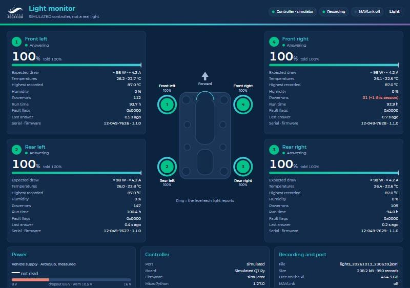

# Light Monitor — a BlueOS extension

The four DeepSea SeaLites on Lutris and their controller, **live, recorded on
the Pi, and summarised into MAVLink** so the light data lands in the same
telemetry log as everything else — the tlog on BlueOS 1.4.x, the mcap on
1.5.x — and in Cockpit and QGroundControl.

Built for [CCR_development#49](https://github.com/Seattle-Aquarium/CCR_development/issues/49)
and [#50](https://github.com/Seattle-Aquarium/CCR_development/issues/50): light 4
going dark at 90–100 %, and all four flickering when the vehicle supply sags
under thrust. The telemetry tells the possibilities apart:

| What the extension sees | What it means |
|---|---|
| a light **stops answering**, then answers with its **power-on count +1** | it lost power, however briefly — wiring, or the brown-out Aaron caught on the scope |
| a light **answers, at the level it was told, but is dark** on camera (or, with a monitor fitted, measured power ≪ expected) | a fault inside the light — DeepSea's; the fault flags may say which |
| a light **answers with a level other than the one it was told** | a command lost on the bus, or a restart into a stale level |
| **all four** drop together as the **vehicle supply** falls toward ~8.6 V | the light converter dropping out (Aaron, #50) |



## What it does

```
light controller --USB--> this extension (the only reader of the port)
   |  every line, verbatim, with the Pi's clock -> /usr/blueos/userdata/light_monitor
   |  each light's state, events                 -> its page, /api/v1/state
   |  NAMED_VALUE_FLOAT + STATUSTEXT             -> mavlink2rest -> tlog / mcap / Cockpit / QGC
   '- vehicle voltage & current, pilot's Lights1 & PilotGain <- mavlink2rest (read-only)
rov_flight_ops (tab 4 "Lights", the Navigation row) <- /api/v1/state, /api/v1/records
```

* **Reads, never writes, the controller.** A Ctrl-C byte on the controller's
  console stops its firmware and turns the lights off; nothing here sends a
  byte. It prefers the controller's **telemetry port** (`…-if02`, see
  `lighting/code/TELEMETRY.md`) and falls back to reading the **console**
  read-only — which is what today's firmware, and Aaron's debug build, print
  to. Both dialects are understood.
* **Release port.** The page's *Release* button closes the controller's port
  for 5–60 minutes so `mpremote` can use it; it reopens on its own, so it
  cannot be forgotten released before a dive.
* **Records everything** to `lights_<UTC start>.jsonl` (every line + events +
  the vehicle's supply each second) and `lights_<UTC start>_1hz.csv` (one
  column per quantity, for R). On the Pi under
  `/usr/blueos/userdata/light_monitor` — File Browser → userdata → light_monitor,
  or *BlueOS logs → light logs* in rov_flight_ops. Pauses below 1 GB free;
  deletes nothing.
* **Publishes to MAVLink** once a controller has been heard (so it stays quiet
  on Nereo): the names below, on change and every 10 s, at most 12 a second,
  as system 1, component 191. Events go out as STATUSTEXT (`Lights: …`) —
  Cockpit and QGC show them, and both logs keep them.

### MAVLink names

| name | meaning |
|---|---|
| `LTn_OK` | light *n* answering (1/0) |
| `LTn_LVL` | light *n*'s own report of its level, % |
| `LTn_PC` | light *n*'s power-on count |
| `LTn_T2`, `LTn_T3` | light *n*'s 2nd and 3rd `STAT?` temperatures, °C (the 1st reads 0) |
| `LTn_RH` | light *n*'s humidity, % (reads 0 on Lutris's lights) |
| `LTn_FLG` | light *n*'s fault flags (DeepSea's code; 0 = none) |
| `LTn_EW` | light *n*'s **expected** draw at its level, W — a model, not measured |
| `LT_CMD`, `LT_PWM`, `LT_SIG` | the controller's commanded level %, PWM µs, signal present |
| `LT_LINK`, `LT_UP`, `LT_LOST` | extension hearing the controller; controller uptime s; lines lost |
| `LT_V`, `LT_A`, `LT_W` | the light supply, **only with a power monitor fitted** |
| `LT_EW` | the four lights' expected total, W |

Unknown values are not sent (no sentinels). In rov_flight_ops' mcap
extraction they appear as `NVF.LT4_LVL` and so on.

## Installing it on a vehicle

1. **Once, on GitHub**: add two repository secrets (Settings → Secrets and
   variables → Actions): `DOCKER_USERNAME` (`zhrandell`) and `DOCKER_PASSWORD`
   (a Docker Hub *access token*, from Docker Hub → Account settings →
   Personal access tokens). The workflow
   `.github/workflows/blueos-light-monitor.yml` then builds the image for the
   Pi (arm/v7 and arm64) on GitHub's machines and pushes it:
   * from any push that changes the extension or the controller code — tag
     `zhrandell/blueos-light-monitor:<branch>`, e.g. `:zhr_light_telemetry`
     (how to put a test build on the bench vehicle before merging) or `:main`;
   * from a git tag `light-monitor-v0.1.0` — `:0.1.0` and `:latest`.
2. **On the vehicle** (it needs internet once, to pull the image — BlueOS
   installs extensions from Docker Hub): BlueOS → *Extensions* → *Installed* →
   **+**:
   * Extension identifier: `seattleaquarium.lightmonitor`
   * Extension name: `Light Monitor`
   * Docker image: `zhrandell/blueos-light-monitor`
   * Docker tag: the tag from step 1
   * Custom settings: copy the `permissions` label from the `Dockerfile`
     (privileged, `/dev`, host networking, the data folder) — BlueOS usually
     fills this in from the image.
3. It starts on every boot. Its page is in the BlueOS menu, and at
   `http://192.168.2.2:9420`.

Works the same on BlueOS 1.4.x and 1.5.x: it uses mavlink2rest on port 6040
(`/mavlink` and `/v1/mavlink` paths both tried) and File Browser's
`userdata`, which both releases have.

## Configuration

Environment variables (set in the Dockerfile; override in BlueOS's custom
settings with `"Env": [...]`):

| variable | default | |
|---|---|---|
| `LIGHT_MONITOR_PORT` | `9420` | the page and API (rov_flight_ops expects 9420) |
| `LIGHT_MONITOR_DATA` | `/data` | the recording folder, inside the container |
| `LIGHT_MONITOR_MODE` | `auto` | `auto` (telemetry port, else console), `data`, `console`, `off` |
| `MAVLINK2REST_URL` | `http://127.0.0.1:6040` | |
| `LIGHT_MONITOR_NO_MAVLINK` | | set to `1` to publish nothing |
| `LIGHT_MONITOR_COMPONENT` | `191` | the MAVLink component id it sends as |
| `LIGHT_MONITOR_VEHICLE_WARN_V` | `10.5` | warn below this vehicle voltage |
| `LIGHTS_DATA_PORT`, `LIGHTS_CONSOLE_PORT` | | a serial port path, if discovery picks the wrong one |

## API

| | |
|---|---|
| `GET /api/v1/state` | everything (`light_monitor.state/1`) — what the page and rov_flight_ops read |
| `GET /api/v1/records?after=N` | the recording's records after id N (the last ~20,000 are held) |
| `GET /api/v1/files`, `GET /files/<name>` | the recordings on the Pi |
| `POST /api/v1/port/release {"minutes": 15}`, `POST /api/v1/port/resume` | |
| `GET /register_service` | for BlueOS |

## Working on it without a vehicle

```
cd blueos_extensions/light_monitor
python -m light_monitor --simulate --sim-monitor --no-mavlink --data ./sim_data
# open http://localhost:9420
python -m pytest tests
```

The simulator plays what has been seen on Lutris: the pilot stepping 0 → 50 →
100 → 80 → 0 %, light 4 browning out now and then at ≥ 90 % (stops answering
for ~3 s, comes back with its power-on count +1), eight-column `STAT?`.
`--sim-monitor` adds the power monitor Lutris does not have. rov_flight_ops'
Lights tab works against it too: set the vehicle address to `127.0.0.1`.

## Assumptions to check on the vehicle

Written down rather than hidden — see also `lighting/code/TELEMETRY.md`:

* **Light positions**: 1 front left, 2 rear left, 3 rear right, 4 front right,
  and RS-485 address *n* = light *n*. (Taken as "lower right" = rear right.)
* **The controller's USB names** contain "MicroPython" (rp2 builds report
  that manufacturer); the telemetry port is interface 2.
* **mavlink2rest accepts posts** from an extension at `127.0.0.1:6040` with
  host networking on both BlueOS releases, and BlueOS 1.4's tlog keeps
  them — mavlink-router's source says it accepts broadcast messages from any
  sender; one bench check confirms it.
* **Component 191** collides with nothing on the vehicle.
* **Expected power** = 98 W × DeepSea's dimming curve: measured only at 100 %.
* **Port 9420** is free on the Pi.
* `SYS_STATUS.voltage_battery` on Lutris is the tether supply that also feeds
  the light box's boost converter.
